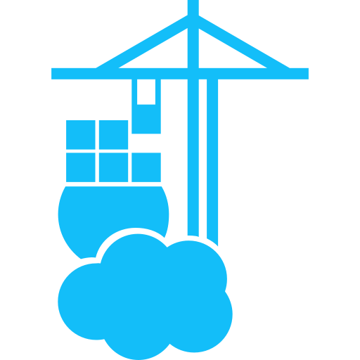

<p align="center">
  <picture>
    <source media="(prefers-color-scheme: dark)" srcset="assets/icon-dark.svg">
    
  </picture>
</p>

<h1 align="center">aac-portainer-agent</h1>

<p align="center">Self-hosted deployment definition for the Portainer Agent, the management agent for Portainer.</p>

<p align="center">
  <a href="https://github.com/portainer/agent"></a>
  <a href="https://hub.docker.com/r/portainer/agent"></a>
  <a href="https://github.com/portainer/agent/blob/develop/LICENSE"></a>
</p>

## About

The Portainer Agent is a small proxy that runs on a Docker host and lets a Portainer
server manage that host's node-specific resources (containers, images, networks, volumes).
On Docker Swarm it also aggregates cluster-wide resources across nodes, so one API request
from the Portainer server reaches every agent in the cluster.

Key features (as provided by upstream):

- Exposes the local Docker API to a Portainer server over a single port
- Aggregates cluster-aware resources (services, tasks, configs, secrets) on Swarm
- Forms an agent cluster over the network so nodes can be queried from one place

## Upstream

- Project: <https://github.com/portainer/agent>
- Portainer documentation: <https://docs.portainer.io/>
- Container image: `portainer/agent:3.0.0` (Docker Hub)
- License: zlib-style license (upstream `LICENSE` file, Copyright Portainer.io)

## Quick start (Docker Compose)

The Compose file is rendered from `service.yml` by the App-as-Code template engine. The
service declares no external Docker networks, so none need to be created beforehand.

```bash
# Set the values listed under "Configuration" in .env if they differ from the defaults
docker compose up -d
```

This service declares no secrets. Nothing needs to be provided beyond the defaults.

## Configuration

Environment variables (defaults from `service.yml`):

| Variable | Default | Description |
|---|---|---|
| `PUID` | `1000` | User ID the container runs as |
| `PGID` | `1000` | Group ID the container runs as |
| `TZ` | `Europe/Berlin` | Time zone |

Ports:

| Port | Protocol | Purpose |
|---|---|---|
| `9001` | TCP | Agent API (`agent`), exposed to the network |

Volumes:

| Mount | Description |
|---|---|
| `/var/run/docker.sock` -> `/var/run/docker.sock` | Docker socket of the host (bind mount) |
| `/var/lib/docker/volumes` -> `/var/lib/docker/volumes` | Docker volume data of the host (bind mount) |
| `/` -> `/host` | Host root filesystem (bind mount) |

> **Note:** The Docker socket and the host root mount give the agent root-equivalent access
> to the host. Expose port `9001` only to the Portainer server that manages this host.

## Deploy with App-as-Code

1. Edit `service.yml`. It is the single source of truth for image, ports, environment,
   volumes, dependencies and per-stage overrides. Do not edit the rendered output.
2. Pushing to `main` (or a configured stage branch) runs the service pipeline, which renders
   the manifests with `aac-template-engine` and triggers the deployment.
3. Releases of this definition are published under <https://github.com/app-as-code/aac-portainer-agent>.

## Credits and license

Portainer Agent is developed by Portainer.io under a zlib-style license. This repository only
contains the deployment definition for it and is not a fork of the application. The logo is
provided by the Portainer project; see [`assets/ICON_SOURCE.md`](assets/ICON_SOURCE.md) for
icon sources and licenses.
